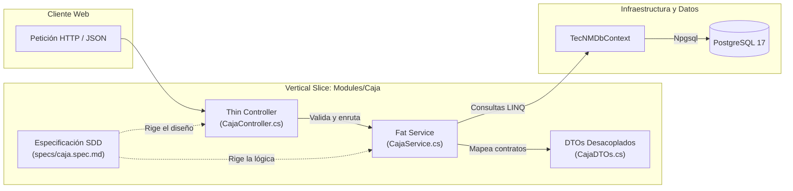
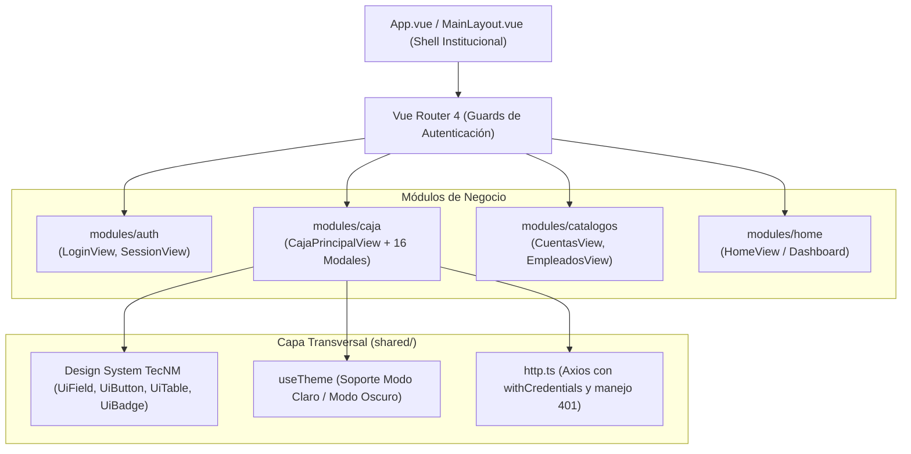
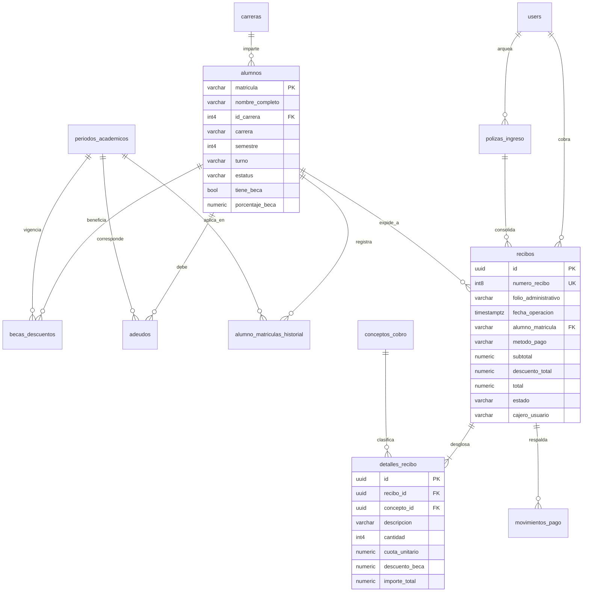

# Sistema de Control de Caja Universitaria e Ingresos Propios
### Tecnológico Nacional de México — Campus Monclova (ITSM)

[](https://dotnet.microsoft.com/)
[](https://vuejs.org/)
[](https://www.typescriptlang.org/)
[](https://www.postgresql.org/)
[](https://www.docker.com/)

---

## 📌 1. Propósito del Proyecto

El **Sistema de Control de Caja Universitaria e Ingresos Propios** es la plataforma institucional oficial desarrollada para el **TecNM Campus Monclova (Instituto Tecnológico Superior de Monclova)** con el fin de modernizar, centralizar, transparentar y auditar la totalidad de las operaciones de captación financiera por concepto de ingresos propios:

* Cuotas de inscripción y reinscripción semestral.
* Trámites escolares (constancias de estudio, kardex, reposición de credencial).
* Cursos de verano, diplomados, propedéuticos y certificaciones de idiomas (TOEFL).
* Derechos de titulación, exámenes profesionales y servicios del centro de cómputo.
* Conciliación de depósitos bancarios referenciados y cobros en efectivo en ventanilla.

El sistema reemplaza procesos manuales y hojas de cálculo dispersas por una solución web robusta con alta disponibilidad, foliado correlativo infranqueable, cierre contable diario y emisión estricta de **Pólizas de Ingresos Propios** conforme a los lineamientos de la administración pública y el modelo de calidad TecNM.

---

## 🎯 2. Objetivos Principales

1. **Emisión y Control Seguro de Recibos:** Generar comprobantes de pago institucionales con foliado consecutivo inalterable, registro de fecha de operación, cajero responsable y método de liquidación (Efectivo / Banco).
2. **Arqueo y Corte Diario Automatizado:** Calcular en tiempo real el balance de caja por turno (Matutino, Vespertino, Nocturno) discriminando entre efectivo físico recibido en caja y transacciones bancarias.
3. **Póliza Oficial de Ingresos Propios:** Consolidar automáticamente los ingresos de la jornada agrupados por cuentas contables armonizadas:
   * **Cuenta 5200:** Ingresos captados en ventanilla (Efectivo).
   * **Cuenta 5400:** Ingresos captados vía depósito bancario referenciado.
   * Emisión e impresión oficial de la póliza en una sola hoja estándar con firmas de elaboración y revisión.
4. **Administración de Adeudos y Becas Institucionales:** Vinculación directa con el padrón de alumnos para aplicar descuentos autorizados (25%, 50%, 100%) y amortizar saldos pendientes automáticamente al registrar cada pago.
5. **Algoritmo de Referencias Bancarias (5+5):** Descomposición y validación algorítmica de referencias bancarias institucionales para identificar automáticamente al estudiante (primeros 5 dígitos) y el concepto arancelario pagado (últimos 5 dígitos).
6. **Seguridad y Trazabilidad de Cancelaciones:** Protocolo estricto para anular recibos erróneos, exigiendo justificación obligatoria y preservando la huella de auditoría del usuario que realizó la cancelación.

---

## 📄 3. Control Documental

| Atributo | Detalle |
| :--- | :--- |
| **Código del Documento** | `ITSM-CAJA-SDD-2026-v2.4` |
| **Proyecto** | Sistema de Control de Caja Universitaria e Ingresos Propios |
| **Institución** | Instituto Tecnológico Superior de Monclova (TecNM) |
| **Versión Actual** | `v2.4.0` (Fase de Pruebas Integrales y Reportes Oficiales) |
| **Última Actualización** | 18 de Noviembre de 2026 |
| **Metodología** | Spec-Driven Development (SDD) + Screaming Architecture |
| **Equipo de Desarrollo** | Lizeth (`LizTec389`), Estefanía Villa (`Estefaniavilla`), María Fernanda Jiménez (`Mafer-imenez28`) |
| **Supervisión y Dirección** | `RubenTecNM` / Academia de Ingeniería en Sistemas Computacionales |
| **Estado del Ciclo de Vida** | En Desarrollo Activo / Pre-Producción |

---

## 👥 4. Actores en el Sistema

```mermaid
graph TD
    Admin["👔 Administrador / Recursos Financieros"]
    Cajero["💼 Cajero de Ventanilla (Turno Matutino / Nocturno)"]
    Alumno["🎓 Alumno / Contribuyente"]
    Auditor["📑 Auditor Contable / Control Escolar"]

    Admin -->|Gestiona| Cat["Catálogos, Cuentas Contables y Empleados"]
    Admin -->|Supervisa| Pol["Pólizas, Arqueos Generales y Cortes Globales"]
    Admin -->|Autoriza| Canc["Cancelación de Recibos y Descuentos"]

    Cajero -->|Opera| Cobro["Cobro en Ventanilla y Búsqueda de Matrículas"]
    Cajero -->|Registra| Dep["Depósitos Bancarios (5+5)"]
    Cajero -->|Genera| Recibo["Emisión e Impresión de Recibos Oficiales"]
    Cajero -->|Realiza| Corte["Corte de Caja Diario por Turno"]

    Alumno -->|Realiza| Pago["Pago de Aranceles, Constancias y Colegiaturas"]
    Alumno -->|Recibe| Comp["Comprobante Oficial de Ingreso"]

    Auditor -->|Verifica| Rep["Reportes de Ingresos, Deudores y Verano"]
    Auditor -->|Audita| Traz["Trazabilidad de Movimientos y Pólizas"]
```



1. **Administrador General / Jefe de Recursos Financieros (`Admin`):**
   * Control total de cuentas contables, catálogo de cuotas arancelarias y personal de caja.
   * Consulta de cortes globales consolidados y emisión de pólizas de periodos extendidos.
   * Supervisión y autorización de cancelaciones de recibos oficiales.
2. **Cajero Operativo (`Cajero`):**
   * Búsqueda ágil de expedientes de alumnos por matrícula o nombre completo.
   * Registro de partidas de cobro, aplicación de becas y emisión de recibos en ventanilla.
   * Captura y desglose de referencias de depósito bancario.
   * Realización del corte de caja diario de su turno e impresión de la póliza de ingresos.
3. **Alumno / Aspirante / Egresado (`Contribuyente`):**
   * Sujeto pasivo del cobro; titular del expediente, becas y adeudos arancelarios.
   * Receptor del recibo institucional foliado como comprobante legal de no adeudo.
4. **Auditor Interno / Control Escolar (`Auditor`):**
   * Consulta analítica de reportes de deudores por fecha de corte, periodo o carrera.
   * Auditoría de folios cancelados y verificación de coincidencia entre banco y caja.

---

## 🛠️ 5. Tecnologías Utilizadas

### A. Backend (.NET 10 Web API)
* **Lenguaje:** C# 14 / .NET 10 SDK.
* **Framework:** ASP.NET Core Web API (Thin Controllers + Fat Services).
* **ORM:** Entity Framework Core 10 (Code-First mapeado a PostgreSQL con Npgsql).
* **Seguridad y Autenticación:** 
  * Tokens JWT (JSON Web Tokens) transmitidos exclusivamente mediante cookies seguras `HttpOnly`, `SameSite=Lax`.
  * Hashing criptográfico de contraseñas mediante `PasswordHasher<User>` (PBKDF2 con SHA-256).
* **Inyección de Dependencias:** Contenedor nativo de .NET (`Microsoft.Extensions.DependencyInjection`).
* **Concurrencia y Resiliencia:** Manejo asíncrono con `CancellationToken` en todas las operaciones I/O y LINQ.

### B. Frontend (Vue 3 + Vite + TypeScript)
* **Framework SPA:** Vue 3 (Composition API pura con `<script setup lang="ts">`).
* **Lenguaje:** TypeScript 5+ con tipado estricto de DTOs y modelos.
* **Empaquetador:** Vite 6+ con recarga rápida en caliente (HMR).
* **Enrutamiento:** Vue Router 4 con guardias de navegación para protección de rutas autenticadas.
* **Diseño e Interfaz:**
  * CSS Semántico propio basado en tokens de color oficiales del TecNM (Guinda Institucional `#1B396A`, Azul Tec `#1B396A`, Dorado `#D4AF37`).
  * Modo Oscuro / Modo Claro reactivo sincronizado con almacenamiento local.
  * Componentes modulares accesibles (`UiField`, `UiButton`, `UiBadge`, `UiTable`, etc.).
* **Generación de Reportes y Exportación:**
  * Aislamiento de impresión mediante `<iframe>` dinámico para garantizar formato oficial en **1 sola página carta**.
  * Exportación de tablas de depósitos bancarios a Microsoft Excel (.xlsx / CSV).
* **Iconografía:** Lucide Vue Next.

### C. Base de Datos (PostgreSQL 17)
* **Motor:** PostgreSQL 17 optimizado en contenedor Docker.
* **Esquema:** 13 tablas relacionales normalizadas (3NF) con claves foráneas, índices únicos y precisión monetaria `NUMERIC(12, 4)`.
* **Vistas Contables:**
  * `vw_corte_diario_caja`: Consolidado diario de cobro en efectivo vs depósito bancario.
  * `vw_reporte_recibos_detallado`: Detalle analítico por partida arancelaria.
  * `vw_adeudos_estudiantes`: Estado de cuenta consolidado de adeudos por alumno.
* **Administración:** pgAdmin 4 Web integrado en el entorno Docker.

---

## 🏛️ 6. Estructura del Proyecto

### A. Estructura Global del Repositorio

```text
TecNM_Incomes/
├── .obsidian/                     # Notas de diseño y canvases de arquitectura
├── backend/                       # API RESTful en C# / .NET 10
│   ├── Core/Entities/             # Entidades del dominio relacional (POCOs)
│   ├── Data/                      # TecNMDbContext y configuración Fluent API
│   ├── Modules/
│   │   ├── Auth/                  # Slice Vertical de Autenticación y JWT
│   │   │   ├── specs/             # Especificaciones SDD de Auth
│   │   │   ├── AuthController.cs  # Enrutamiento de login, logout y sesión
│   │   │   ├── AuthService.cs     # Validación y emisión de tokens
│   │   │   └── AuthDTOs.cs        # Contratos de petición y respuesta
│   │   └── Caja/                  # Slice Vertical de Caja e Ingresos Propios
│   │       ├── specs/             # Especificaciones SDD de Cobro y Reportes
│   │       ├── CajaController.cs  # 26 Endpoints de caja, catálogo y pólizas
│   │       ├── CajaService.cs     # Reglas de negocio, arqueos y adeudos
│   │       └── CajaDTOs.cs        # Contratos de transferencia de datos
│   ├── Program.cs                 # Bootstrap del servidor, CORS, DI y middlewares
│   ├── TecNM.Api.csproj           # Manifiesto del proyecto .NET 10
│   └── Dockerfile                 # Imagen de compilación y runtime de backend
│
├── frontend/                      # Aplicación SPA en Vue 3 + TypeScript
│   ├── src/
│   │   ├── app/                   # Bootstrap raíz de la aplicación (App.vue, router)
│   │   ├── modules/
│   │   │   ├── auth/              # Vistas y lógica de inicio de sesión
│   │   │   ├── caja/              # Módulo neurálgico de cobranza
│   │   │   │   ├── api/           # Cliente HTTP con endpoints de caja
│   │   │   │   ├── components/    # 16 Modales especializados de operación
│   │   │   │   ├── types/         # Interfaces TypeScript del dominio
│   │   │   │   └── views/         # CajaPrincipalView.vue (Ventanilla de Cobro)
│   │   │   ├── catalogos/         # Administración de Cuentas y Empleados
│   │   │   └── home/              # Dashboard de bienvenida y accesos rápidos
│   │   └── shared/                # Design System institucional (tokens, botones, modales)
│   ├── index.html                 # Punto de montaje del DOM
│   ├── vite.config.ts             # Configuración del empaquetador Vite
│   └── Dockerfile                 # Imagen para servir el frontend
│
├── scripts/
│   ├── migrations/                # Scripts SQL de migración en 3 etapas del profesor:
│   │   ├── 01_stage1_structure_en.sql   # Etapa 1: Estructura de tablas
│   │   ├── 02_stage2_data_en.sql        # Etapa 2: Población de datos semilla
│   │   └── 03_stage3_audit_and_views_en.sql # Etapa 3: Vistas y auditoría
│   └── seed_poliza_29_octubre.sql # Datos de prueba para corte contable
│
├── docker-compose.yml             # Orquestación integral (DB, Backend, Frontend)
├── AUTH.md                        # Estándar de autenticación y sesiones
├── BACKEND_ARCHITECTURE.md        # Lineamientos técnicos del backend .NET 10
├── FRONTEND_ARCHITECTURE.md       # Lineamientos técnicos del frontend Vue 3
├── DICCIONARIO_DE_DATOS_CAJA.md   # Diccionario oficial de campos y relaciones
├── DIAGRAMA_ER_COMPLETO.md        # Diagrama de Entidad-Relación extendido
└── README.md                      # Documento maestro del proyecto
```

---

### B. Arquitectura del Backend (.NET 10 — Vertical Slice)

El backend implementa **Screaming Architecture / Vertical Slices**, donde el código se agrupa por capacidades de negocio y no por capas técnicas horizontales:



* **Thin Controllers:** Únicamente reciben peticiones HTTP, validan tokens y delegan al servicio correspondiente; nunca contienen lógica de negocio directa.
* **Fat Services:** Concentran toda la lógica de cálculo contable, validaciones de aranceles, amortización de adeudos y manejo de transacciones.
* **DTOs Desacoplados:** Se garantiza que ninguna entidad del ORM (`Recibo`, `Alumno`, `User`) sea expuesta directamente al frontend.

---

### C. Arquitectura del Frontend (Vue 3 Modular)

El frontend está estructurado en módulos desacoplados con lazy-loading que comparten una capa común de diseño institucional:



#### Catálogo de los 16 Modales de Caja (`src/modules/caja/components/`)
1. **`ModalPolizaIngresos.vue`:** Póliza oficial del corte con resumen de cuentas 5200/5400 e impresión aislada en hoja única.
2. **`ModalPolizaIngresoPeriodo.vue`:** Consulta de pólizas por rangos de fechas extendidos.
3. **`ModalDepositoBancario.vue`:** Captura y desglose de referencias 5+5 con exportador Excel.
4. **`ModalDepositoBancarioPropedeutico.vue`:** Registro especializado de depósitos para aspirantes a propedéutico.
5. **`ModalConsultaCancelacionRecibos.vue`:** Búsqueda histórica y cancelación formal de recibos.
6. **`ModalReciboProvisional.vue`:** Emisión de recibos provisorios sujetos a formalización.
7. **`ModalReciboProvisionalCancelar.vue`:** Anulación de recibos provisionales caducados.
8. **`ModalReporteDeudores.vue`:** Reporte maestro de adeudos con filtrado por alumno y carrera.
9. **`ModalReporteDeudoresFechaCorte.vue`:** Arqueo de deudores a una fecha de corte específica.
10. **`ModalReporteDeudoresFechaCuenta.vue`:** Deudores segmentados por cuenta contable arancelaria.
11. **`ModalReporteDeudoresInscritos.vue`:** Adeudos focalizados exclusivamente en alumnos inscritos.
12. **`ModalReporteIngresos.vue`:** Reporte general de captación financiera por fecha.
13. **`ModalReporteIngresosPeriodo.vue`:** Reporte financiero acumulado por periodo semestral.
14. **`ModalReporteVarios.vue`:** Reporte misceláneo de aranceles administrativos.
15. **`ModalImprimeVerano.vue`:** Emisión y cálculo de aranceles de cursos intersemestrales de verano.
16. **`ModalCuentas.vue` / `ModalEmpleados.vue`:** Edición de cuentas contables y personal operativo.

---

### D. Esquema de Base de Datos (13 Tablas Principales)



---

## 🤖 7. Desarrollo Guiado por Especificaciones (Spec-Driven Development - SDD)

Este proyecto fue concebido, estructurado y desarrollado bajo la metodología **Spec-Driven Development (SDD)**:

1. **Especificación Primero:** Ningún componente o endpoint se escribe sin haber redactado previamente su documento de requerimientos técnicos en la carpeta `specs/` co-localizada dentro de su respectivo módulo.
2. **Contexto Maestro (`AGENTS.md`):** Tanto en la raíz como en `backend/AGENTS.md` y `frontend/AGENTS.md` existen manifiestos maestros que guían el trabajo asistido por agentes de Inteligencia Artificial, delimitando reglas operativas, normas de codificación y mapas de componentes.
3. **Validación Continua:** Toda implementación de endpoints y vistas se contrasta directamente contra los criterios de aceptación y contratos JSON definidos en las especificaciones.

---

## 📚 8. Enlaces a Documentación Clave

| Documento | Descripción |
| :--- | :--- |
| **[AUTH.md](./AUTH.md)** | Estándar de seguridad, ciclo de vida del JWT, cookies `HttpOnly` y sesiones. |
| **[BACKEND_ARCHITECTURE.md](./BACKEND_ARCHITECTURE.md)** | Arquitectura de la API en .NET 10, controllers delgados y servicios de negocio. |
| **[FRONTEND_ARCHITECTURE.md](./FRONTEND_ARCHITECTURE.md)** | Arquitectura de la SPA en Vue 3, Vite, diseño institucional y ruteo modular. |
| **[DICCIONARIO_DE_DATOS_CAJA.md](./DICCIONARIO_DE_DATOS_CAJA.md)** | Diccionario técnico con tipos de datos, llaves foráneas y catálogos de `cajadb`. |
| **[DIAGRAMA_ER_COMPLETO.md](./DIAGRAMA_ER_COMPLETO.md)** | Diagrama relacional expandido con todas las entidades y cardinalidades. |
| **[ESQUEMA_TABLAS.md](./ESQUEMA_TABLAS.md)** | Análisis integral de las tablas institucionales del TecNM. |
| **[plans/01-auth-implementation.md](./plans/01-auth-implementation.md)** | Plan de construcción y verificación del módulo de autenticación. |

---

## 🚀 9. Instalación y Despliegue Rápido (Docker)

El proyecto se encuentra 100% contenerizado. Para desplegar el ecosistema completo (Base de datos, Backend y Frontend):

```bash
# 1. Clonar el repositorio
git clone https://github.com/RubenTecNM/TecNM_Incomes.git
cd TecNM_Incomes

# 2. Levantar todos los servicios con Docker Compose
docker compose up -d --build
```

### Servicios Disponibles:
* **Frontend Web (Vue 3 + Vite):** [http://localhost:6030](http://localhost:6030)
* **Backend REST API (.NET 10):** [http://localhost:6040](http://localhost:6040)
* **Health Check Backend:** [http://localhost:6040/api/health](http://localhost:6040/api/health)
* **Base de Datos PostgreSQL 17:** `localhost:5432` (Base de datos: `cajadb`)
* **pgAdmin 4 (Administrador Web DB):** [http://localhost:5050](http://localhost:5050)

### Credenciales Predefinidas para Pruebas:
| Rol | Usuario | Contraseña | Propósito |
| :--- | :--- | :--- | :--- |
| **Administrador** | `admin` | `Password123!` | Acceso total a catálogos, arqueos y reportes |
| **Cajero Matutino** | `cajero1` | `Password123!` | Operación y cobro en ventanilla turno matutino |
| **Cajero Nocturno** | `cajero2` | `Password123!` | Operación y cobro en ventanilla turno nocturno |

---

## 🏆 10. Créditos y Equipo de Desarrollo

Este proyecto ha sido desarrollado con dedicación y rigor institucional por el equipo de estudiantes de la carrera de **Ingeniería en Sistemas Computacionales** del **Instituto Tecnológico Superior de Monclova (TecNM Campus Monclova)**:

* **Lizeth (`LizTec389` / `Lana`):** Integración general, módulo de autenticación, control de pólizas contables, aislamiento de impresión y arquitectura de vistas.
* **Estefanía Villa (`Estefaniavilla`):** Desarrollo del frontend interactivo, componentes de depósitos bancarios, diseño UI y soporte de temas (Dark / Light).
* **María Fernanda Jiménez (`Mafer-imenez28`):** Diseño de la base de datos relacional, migración formal a esquema canónico en 3 etapas (Estructura, Datos, Auditoría) y vistas contables.
* **RubenTecNM:** Dirección del repositorio y supervisión académica institucional.

---
*TecNM Campus Monclova — "Excelencia en Educación Tecnológica"*
